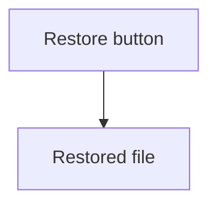

# The nerDDocs format

This doc covers the format of a nerDDocs docs folder: its files, `nerddocs.json`, fences, page content and the problems that `npx nerddocs check` finds.

All examples come from the docs of one made-up product, a backup app. Its docs folder holds `nerddocs.json` and the pages 'Install the agent', 'Restore a file', 'Schedules' and 'Encryption'.

## The docs folder

`npx nerddocs <folder>` shows a folder as a site. With no folder, it shows `./docs` when it exists, and the current folder otherwise. `nerddocs.json` sits at the top of the folder.

- Each Markdown file is a page, and each folder is a row of the contents panel.
- The first heading of a file is the title of its page. A file with no heading takes its file name as its title.
- File names set the order. A prefix of up to three digits and then `-`, `_`, `.` or a space sets only the order. So `01-install.md` comes before `02-restore.md`.
- A file name of four digits, such as `2024-report.md`, has no prefix.
- A folder with an `index.md`, or else a `README.md`, is one row with the title of that page. That page comes first in its folder.
- Dot folders, dot files, `node_modules` and a top folder named `__nerddocs` stay out of the site.

The address of a page is the path of its file without the order prefixes, so `user-guide/01-backups/01-restore.md` opens at `/user-guide/backups/restore.html`. When two names in one folder give one address, the name with no prefix takes it, or else the first name in the order. Each other name keeps its prefix in its address.

Name each new page with a two-digit order prefix, such as `02-restore.md`, so that the pages keep their order.

## nerddocs.json

`nerddocs.json` lists the levels, from the plainest to the deepest. This is the file of the backup app:

```json
{
  "levels": [
    { "id": "basics", "name": "Basics", "icon": "eye" },
    { "id": "details", "name": "Details", "icon": "list" },
    { "id": "internals", "name": "Internals", "icon": "cpu" }
  ],
  "defaultLevel": "basics"
}
```

| Key | In | What it does |
|---|---|---|
| `levels` | The file | Lists the levels in the order of their stops on the slider. `false` makes a site with no levels. |
| `id` | A level | Names the level in fences and in the hash of a link. It holds letters, digits, `-`, `_` and `.`. Each level needs an `id`. |
| `name` | A level or a dimension | Sets the name that the stop, or the button and the list of dimensions, shows. The default comes from the id or the folder, so `on-call` shows as 'On call'. |
| `icon` | A level | Sets the icon of the stop, from the table of [Icons](#icons). The default is the first letter of the name in a circle. |
| `defaultLevel` | The file | Sets the level that a page opens at. The default is the first level. |
| `wordsPerMinute` | The file | Sets the reading speed of the read time, as a number above 0. The default is `238`. |
| `textWidth` | The file | Sets the characters on a line of text, as a number above 0. The default is `75`. |
| `dimensions` | The file | Lists the dimensions, as [Dimensions](#dimensions) says. |
| `folder` | A dimension | Sets the top folder of the dimension, such as `user-guide`. Each dimension needs a `folder`. |

Every key except `id` and `folder` is optional. With no `nerddocs.json`, the check prints 'Missing config', and each fence line shows as text. A file that is not valid gives 'Bad config'. With one level, no slider shows.

### Icons

| Icon | What it shows |
|---|---|
| `eye` | An eye |
| `list` | A list with checks |
| `cpu` | A chip |
| `brief` | A briefcase |
| `code` | Two angle brackets and a slash |
| `flask` | A flask |
| `book` | A book |
| `clock` | A clock |

Pick the icon whose picture fits the level, such as `eye` for 'Basics' and `cpu` for 'Internals'. Any other icon gives 'Unknown icon', and the level shows its default icon.

### Dimensions

A dimension is a top folder of the docs that the contents panel shows on its own, such as 'User guide' and 'Administration'. The key `dimensions` lists them:

```json
{
  "dimensions": [
    { "folder": "user-guide" },
    { "folder": "administration" },
    { "folder": "legal", "name": "Legal and privacy" }
  ]
}
```

- A `folder` holds no `/`, and each folder shows once in the list.
- Every dimension has the levels of `nerddocs.json`.
- A listed folder that is missing or holds no page gives 'Missing dimension'.
- A Markdown file or a folder of pages outside every listed folder stays out of the site, and gives 'Outside dimensions'.
- The `index.md` of the folder of a dimension stays a page row.

## Fences

A fence marks text for one or more levels. A line with `:::` and level ids opens a part, and a line with `:::` alone closes it. This is `docs/02-restore.md` of the backup app:

```md
# Restore a file

Pick a file and a day, and the app puts that copy back.


::: details internals
REQ-2.1 The app restores any file from any day of the last 14 days.

REQ-2.2 A restore never changes the copy in storage.

::: internals
A restore is a job on the storage server. The server queues the job and sends the file blocks to the agent.

## Search index

The agent keeps a list of the file paths of each copy.
:::

## Pick a day

Click a day on the calendar. A day with a copy has a dot.

::: internals
A copy is open while the backup runs, and closed once the last block is stored.

The rule takes the newest closed copy of that day.
:::
```

- Text outside a fence shows at every level.
- A fence with two or more ids shows its part at each of those levels. So the requirements above show at 'Details' and 'Internals'.
- A new opening fence closes the part before it, and the end of the file closes an open part.
- A fence starts at the left margin, with at most three spaces before it.
- A fence line inside a code block stays text.
- A fence line with an id that `nerddocs.json` does not list stays text, and gives 'Unknown level'.
- A heading inside a fence never becomes the title of the page.
- A top-level heading outside a fence hides at each level that has no text in its section, when another level has text there.
- To show a line `:::` inside a part, write `\:::`.

A fence goes between blocks only. Write a list or a table whole in each part, and write a changed sentence as a whole paragraph in each part.

A page need not have text at every level. A page with no text at a level opens at the nearest lower level with text, or else at the nearest higher level with text.

## Headings

Write each heading as on GitHub, such as `## Pick a day`. The outline of a page lists the two highest ranks of heading that the page uses. In a file that uses `#` for its sections, the first `#` heading is the title.

A heading inside a fence shows only at the levels of the fence, so 'Search index' shows at 'Internals' only. A heading outside a fence hides at each level with no text under it, as [Fences](#fences) says, so it gives no 'Empty heading' while another level has text under it. When no level has text under it, it gives 'Empty heading'.

The id of a heading is its text in lowercase, with each space as `-`. Marks other than `-` and `_` drop out. So 'Pick a day' has the id `pick-a-day`, and 'POST /restores' has `post-restores`. A second heading with the same text gets `-1` after its id.

## Links

A link to a Markdown file opens its page. The path starts from the folder of the page. This is `docs/03-schedules.md`:

```md
# Schedules

The app backs up each PC every night. It keeps each copy for 30 days.

::: details internals
REQ-1.1 The agent starts a backup at 01:00 local time every day.

REQ-1.2 A backup that misses its time runs within 10 minutes after the PC wakes.

The rule for which copy a day restores is in [Pick a day](02-restore.md#internals/pick-a-day).
:::
```

The hash of a link can name a level, a heading or both:

| Hash | What the link opens |
|---|---|
| `02-restore.md#internals` | The 'Restore a file' page at 'Internals'. |
| `02-restore.md#internals/pick-a-day` | The page at 'Internals', with the heading 'Pick a day' at the top of the window. |
| `02-restore.md#search-index` | The page at a level that shows the heading 'Search index'. |

A link to a page that is not in the docs gives 'Missing page'. A link to a heading that its page lacks gives 'Missing heading'. With a level in the hash, the heading must show at that level.

A link that opens its page at another level than the reader's shows the icon of that level after its text. Name a level in the hash when the text of the link target shows at that level only. The rule under 'Pick a day' shows at 'Internals' only, so the link names `internals`.

## Images

Write an image on a line of its own, as on GitHub:

```text

```

The path starts from the folder of the page. A path that starts with `/` starts from the docs folder. A PNG, JPEG, GIF, WebP, SVG or AVIF file shows as an image. An image that is missing, or outside the docs folder, gives 'Missing file'.

To set the width of an image, write it as a raw `` with a `width` in pixels:

```html

```

To show a light copy and a dark copy of an image, write the two images on two lines:

```text


```

## Tables

Write a table as on GitHub, with a header row. Alignment marks such as `|:---|---:|` work as on GitHub, and so does a raw HTML `<table>`. A table wider than the text column scrolls sideways in its own box.

## Code blocks

Write the language word after the opening fence of a code block, as on GitHub. This block holds the command that installs the agent:

```sh
setup.exe /quiet SERVER=backup.example.com
```

These fence words get code colors, in any case:

| Language | Fence words |
|---|---|
| Shell | `sh`, `bash`, `shell`, `zsh`, `shellscript` |
| Shell session | `console`, `shellsession` |
| PowerShell | `powershell`, `ps`, `ps1`, `pwsh` |
| JSON | `json` |
| JSON with comments | `jsonc` |
| YAML | `yaml`, `yml` |
| TOML | `toml` |
| INI | `ini`, `properties` |
| XML | `xml` |
| HTML | `html` |
| CSS | `css` |
| JavaScript | `javascript`, `js`, `cjs`, `mjs` |
| TypeScript | `typescript`, `ts`, `cts`, `mts` |
| Python | `python`, `py` |
| Go | `go` |
| Rust | `rust`, `rs` |
| Java | `java` |
| C | `c` |
| C# | `csharp`, `cs`, `c#` |
| SQL | `sql` |
| Diff | `diff` |
| Dockerfile | `docker`, `dockerfile` |
| Markdown | `markdown`, `md` |

A fence with no word, with `text` or with another word shows the code in the text color.

## Box diagrams

A code block with any character from `─` (U+2500) to `╿` (U+257F) shows as a box diagram, with or without a language word. Each line joins and each column stays in place. This diagram is on the 'Architecture' page:

```
┌──────────────┐    copy list    ┌────────────────┐
│ Backup agent │ ──────────────▶ │ Storage server │
│  on the PC   │ ◀────────────── │  keeps copies  │
└──────────────┘   file blocks   └────────────────┘
```

## Mermaid diagrams

Write a Mermaid diagram as on GitHub, in a code block with the word `mermaid`:



An `accTitle:` line, such as `accTitle: Restore a file`, names the diagram for screen readers. An `accDescr:` line describes it. Math between `$$`, `mindmap`, `architecture-beta` and `layout: elk` work too.

A diagram that Mermaid cannot read shows its source under a line such as `Bad Mermaid: user-flows.md:14`. The check prints no problem for it, so keep each diagram of the old docs as it is.

## HTML wireframes

Write an HTML wireframe as an image of its `.html` file, on a line of its own:

```text

```

The page shows the wireframe as a live page in a box. Write each wireframe as one HTML file with all its steps. Name its other files by a path from the folder of the wireframe. A missing wireframe gives 'Missing file'.

## API references

Write an API reference as an image of its OpenAPI file, on a line of its own. The file sits in the docs folder, and its name ends in `.yaml`, `.yml` or `.json`:

```text

```

- nerDDocs reads OpenAPI 2.0, 3.0, 3.1 and 3.2, in YAML or JSON. Write `openapi: 3.0.3` or `openapi: '3.0'`, since YAML reads `openapi: 3.0` as a number.
- Each endpoint shows as a heading, such as `POST /restores`. The headings start one rank below the heading above the image.
- A tag after a `#`, such as `api/openapi.yaml#Restores`, shows the endpoints of that tag only. The tag matches only in the same case.
- A `$ref` points inside the file, such as `#/components/schemas/Restore`, or to another file of the docs folder.

## Check the docs

Run the check on the docs folder:

```sh
npx nerddocs check docs
```

The command prints each problem as a block, then the count of problems, and stops. It exits with `0` when the docs have no problem, and with `1` otherwise. Say that `docs/02-restore.md` holds the heading 'Search index' twice: in the fence of 'Basics' and 'Details', and in the fence of 'Internals'. This block says that the first one has no text after it at 'Basics' and 'Details':

```text
docs/02-restore.md:17  Empty heading  Basics, Details
  17 │ ## Search index
     │ ^^^^^^^^^^^^^^^
  19 │ ::: internals
```

The first line holds the path and the line of the problem, its name, and its value or the levels where it breaks. The next line is the source line, and the carets mark the words of the problem. The last line is the fence line of the part after it.

| Problem | Value | What it finds |
|---|---|---|
| 'Missing config' | None | The folder has no `nerddocs.json`. |
| 'Bad config' | None | `nerddocs.json` is not valid. |
| 'Cannot read' | None | The command cannot read a file or a folder of the docs. |
| 'Duplicate page' | None | A Markdown file gives the address of a page before it, such as `restore.md` after `restore.MD`. It stays out of the site. |
| 'Unknown level' | The id | A fence line, or `defaultLevel`, names an id that `nerddocs.json` does not list. |
| 'Unknown icon' | The icon | `nerddocs.json` names an icon outside the table of [Icons](#icons). |
| 'Missing dimension' | The folder | `dimensions` lists a folder that is missing or holds no page. |
| 'Outside dimensions' | None | A Markdown file or a folder of pages sits outside every folder that `dimensions` lists. |
| 'Missing file' | The target | A page shows an image, a wireframe or an OpenAPI file that is missing or outside the docs folder. |
| 'Bad OpenAPI' | None | An OpenAPI file, or a file that its `$ref` names, is not valid YAML or JSON, or not OpenAPI 2.0, 3.0, 3.1 or 3.2. |
| 'Unresolved ref' | The `$ref` | A `$ref` points to nothing in the docs folder, or to an address such as `https://`. |
| 'Unknown tag' | The tag | A page names a tag after the `#` of an OpenAPI file, and that file does not list it. |
| 'Missing page' | The link | A link points to a Markdown file that is no page of the docs. |
| 'Missing heading' | The link | A link points to a heading that its page lacks, or that does not show at the level in the hash. |
| 'Empty page' | None | A page has no text at any level, such as a page that holds only its title. |
| 'Empty heading' | The levels | A heading in a fence has no text after it at a level of the fence, before the next heading of its rank or higher. |

Fix the problems that a page of a job gives in these ways:

- 'Empty heading': Remove the heading from the fence of each level with no text under it. So 'Search index' stays only in the fence of 'Internals'. When two or more levels share the heading, write it once, outside a fence.
- 'Empty page': Write the page. A page that holds only its title gives this problem until its text is written.
- 'Missing page': Link to the page that holds the text, by its path from the folder of the page.
- 'Missing heading': Link to a heading that shows at the level in the hash, or name the level that shows it.
- 'Missing file': Copy the file next to the page that shows it, and give its path from that page.
- 'Unknown level': Use an id that `nerddocs.json` lists.
