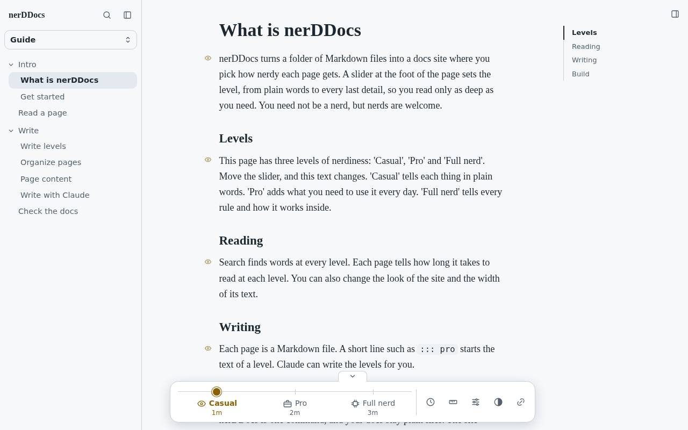

# nerDDocs

This doc covers what nerDDocs is, how to run it and install its Claude skill, and where the other docs are.

nerDDocs is an open-source documentation platform. Each page holds its text at several levels, from plain to full nerd, and the reader moves a slider on the page to switch between them. The author names the levels, and moving to another level changes the text of the page.

A book can come at third-grade, high-school and university levels. Technical docs can come at levels for managers, developers and testers.

<picture>
  <source media="(prefers-color-scheme: dark)" srcset="https://raw.githubusercontent.com/true-byte/nerDDocs/master/docs/guide/01-intro/images/site-dark.png">
  
</picture>

## Run nerDDocs

Run this command in your project's folder:

```sh
npx nerddocs
```

The command shows the Markdown files in `docs/` as a site, and opens it in your browser. To show another folder, name it:

```sh
npx nerddocs guide
```

[Get started](docs/guide/01-intro/02-get-started.md#run-nerddocs) gives each argument of the command.

## Claude Code skill

The `nerddocs` skill tells Claude how to write the docs of a nerDDocs site. With it, Claude writes new pages, moves old docs into nerDDocs, splits pages into levels and fills the missing levels. To install the skill, run this command in your project's folder:

```sh
npx skills add https://github.com/true-byte/nerDDocs --skill nerddocs -a claude-code --copy
```

[Write with Claude](docs/guide/03-write/04-write-with-claude.md) says what to ask Claude, and how to update the skill.

## Docs

The docs of nerDDocs are a nerDDocs site in `docs/`. Run `npx nerddocs` in the clone to read them at each level. On GitHub, a page shows the text of all its levels, with each fence line as text.

| Subject | Page |
|---|---|
| What nerDDocs is and how it works | [What is nerDDocs](docs/guide/01-intro/01-what-is-nerddocs.md) |
| How to read a page at its levels | [Read a page](docs/guide/02-read-a-page.md) |
| How to write text at several levels | [Write levels](docs/guide/03-write/01-write-levels.md) |
| How to write tables, code, diagrams, images, wireframes and API references | [Page content](docs/guide/03-write/03-page-content.md) |
| How to check the docs | [Check the docs](docs/guide/04-check-the-docs.md) |
| What readers, authors, teams and AI tools do with nerDDocs | [Use cases](docs/project/01-use-cases.md) |
| The parts that nerDDocs is built from | [Tech stack](docs/project/02-tech-stack.md) |
| The plan of nerDDocs | [Plan](docs/project/03-plan.md) |

## Contributing

[CONTRIBUTING.md](CONTRIBUTING.md) says how to set up a clone, build and test, write docs, add a theme, send a change and make a release. It also says what each folder of the clone holds.

## License

nerDDocs is under the MIT License. [LICENSE](LICENSE) holds its text. [Tech stack](docs/project/02-tech-stack.md) gives the licenses of the fonts and the packages that ship inside the command.
