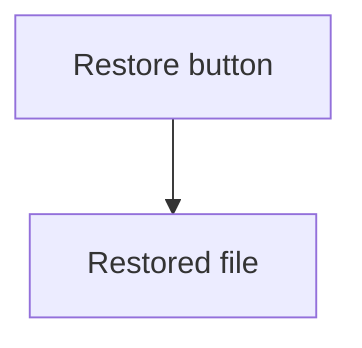

# nerDDocs

This doc covers what nerDDocs is and how to run it. It also covers how to write text at several levels, search the docs, share a link, write page content, split the docs into dimensions, see your saves, check the docs, see the problems, read the terminal lines and see the plan.

nerDDocs is an open-source documentation platform. Each page holds its text at several levels, and the reader moves a slider on the page to switch between them. The author names the levels, and moving to another level changes the text of the page.

A book can come at third-grade, high-school and university levels. Technical docs can come at levels for managers, developers and testers.

## Run nerDDocs

Set up a clone, as [CONTRIBUTING.md](CONTRIBUTING.md#set-up-a-clone) says. Then run this command in the clone:

```sh
npx nerddocs
```

The command shows `./docs` as a site and prints its address and its author address. It opens the author address in your browser, as [See your saves](#see-your-saves) says. Press `Ctrl+C` to stop the command.

To show the docs of the backup app from another folder, run this command:

```sh
npx nerddocs ../backup-app/guide
```

| Argument | What it does |
|---|---|
| `check` | As the first argument, checks the folder once, prints each problem and stops, as [Check the docs](#check-the-docs) says. |
| `[folder]` | Sets the folder to show. The default is `./docs` when it exists, and the current folder otherwise. |
| `--port <port>` | Sets the first port to try. A busy port moves to the next port. The default is `4000`. |
| `--no-open` | Keeps the browser closed. |

Each folder becomes a row of the contents panel, and each Markdown file becomes a page. The first heading of a file is its title, and the file name is the title of a file with no heading.

File names set the order, so `01-restore.md` comes before `02-schedules.md`. A prefix of up to three digits and then `-`, `_`, `.` or a space sets only the order, so `01-restore.md` shows as 'Restore'. A file named `index.md` or `README.md` comes first in its folder. Dot folders, dot files, `node_modules` and a top folder named `__nerddocs` stay out of the site.

A folder with an `index.md`, or else a `README.md`, is one row with the title of that page. A click on its name opens the page, and its arrow 'Subtopics' shows or hides the rows of the other pages and folders in it. With both files, the `index.md` is the page of the folder and the `README.md` is a row under it. A folder whose only page is its `index.md` or `README.md` is a page row. The `index.md` of the docs folder stays a page row, such as 'Welcome'.

A folder with neither file is a row with the name of the folder, and a click on it shows or hides its rows. A folder row that you shut stays shut on every page and after a reload.

The foot of each page links to the page before it and the page after it, in the order of the contents panel. Each link shows the read time of its page at the level that the page opens at for you.

The address of a page is the path of its file without the order prefixes, so `user-guide/01-backups/01-restore.md` opens at `/user-guide/backups/restore.html`. A file name of four digits, such as `2024-report.md`, has no prefix. When two names in one folder give one address, the name with no prefix takes it, or else the first name in the order. Each other name keeps its prefix in its address, so `02-restore.md` next to `01-restore.md` opens at `/02-restore.html`.

A link to a Markdown file, such as `[Restore a file](01-backups/01-restore.md)`, opens its page at its address. An image or a link to any other file keeps the path of its file. An address with the order prefixes, such as `/user-guide/01-backups/01-restore.html`, or the address of a Markdown file opens the page at its address.

The hash of an address can name a level. `restore.html#internals` opens the 'Restore a file' page at 'Internals', and `restore.html#internals/pick-a-day` also brings the heading 'Pick a day' to the top of the window. A link in Markdown names a level the same way, such as `[the rule for a day](restore.md#internals/pick-a-day)`. A page with no text at that level opens at the nearest lower level with text, or else at the nearest higher level with text.

A hash with a heading id alone, such as `restore.html#search-index`, opens the page at a level that shows that heading. On a page with levels, the hash always holds the level that shows, such as `restore.html#overview`, so a copied address opens at the same level. A move of the slider adds no step to Back.

A link in the text has no underline. A link can open its page at a level other than the level that the page opens at for you. Such a link shows the icon of that level after its text, and it takes the color of that level. While 'Restore a file' opens at 'Overview' for you, the link `restore.html#internals/pick-a-day` shows the 'Internals' icon.

Each save of a Markdown file or of `nerddocs.json` shows on the open site with no reload. A browser at the plain address stays at the same place on the page.

## Write text at several levels

Levels need a file named `nerddocs.json` in the folder that the command shows. The file lists the levels:

```json
{
  "levels": [
    { "id": "overview", "name": "Overview", "icon": "eye" },
    { "id": "requirements", "name": "Requirements", "icon": "list" },
    { "id": "internals", "name": "Internals", "icon": "cpu" }
  ],
  "defaultLevel": "overview"
}
```

| Key | What it does |
|---|---|
| `levels` | Lists the levels in the order of their stops on the slider. Each level needs an `id`. Set it to `false` for a site with no levels. |
| `name` | Sets the name that the stop shows. The default comes from the id, so `on-call` shows as 'On call'. |
| `icon` | Sets the icon of the stop: `eye`, `list`, `cpu`, `brief`, `code`, `flask`, `book` or `clock`. The default is the first letter of the name in a circle. |
| `defaultLevel` | Sets the level that a page opens at. The default is the first level. |
| `wordsPerMinute` | Sets the reading speed that the read time uses, as a number above 0. The default is `238`. |
| `textWidth` | Sets the characters on a line of text, as a number above 0. The default is `75`. |

Every key except `id` is optional. A level id holds letters, digits, `-`, `_` and `.`.

The file decides what a page shows:

| File | What the page shows |
|---|---|
| The file is missing | A modal with the title 'No nerddocs.json'. No slider shows, and each fence line shows as text. |
| The file is broken or cannot be read | A modal with the title 'Broken nerddocs.json'. No slider shows, and each fence line shows as text. |
| The file lists no levels, or has `"levels": false` | No modal shows. No slider shows, and each fence line shows as text. |
| The file lists one level | No modal shows. No slider shows, and the text of that level shows with no fence line. |
| The file lists two or more levels, and the page has no part | The toolbar says 'No levels on this page'. |

To keep a site with no levels free of the modal, write `{ "levels": false }` in the file. The box 'Don't show again' in the modal holds for that browser only.

### Mark text with fences

A fence marks text for one or more levels. A line with `:::` and level ids opens a part, and a line with `:::` alone closes it.

This file is the 'Restore a file' page of the backup app:

```md
# Restore a file

::: overview
Pick a file and a day, and the app puts that copy back.

::: requirements
The app restores any file from any day that it still keeps a copy of.

::: internals
A restore is a job on the storage server.
:::

## Pick a day

::: overview requirements
Click a day on the calendar. A day with a copy has a dot.

::: internals
The rule takes the newest closed copy of that day.
:::

A restore never changes the copy in storage.
```

These rules hold for each fence and each part:

- Text outside a fence shows at every level.
- A new opening fence closes the part before it, and the end of the file closes an open part.
- A fence starts at the left margin, with at most three spaces before it.
- A fence line inside a code block stays text.
- A fence line with an id that `nerddocs.json` does not list stays text on its own line. It neither opens nor closes a part.
- A line with `:::` alone stays text on its own line when no part is open.
- A heading inside a fence never becomes the title of the page.
- A top-level shared heading or `<details>` hides at a level with no text in it, when another level has text there. The text of a heading runs to the next heading of the same or higher rank.

To show a line with `:::` inside a part, write `\:::`. The page prints `:::`, and the part stays open.

A fence goes between blocks only. Write a list or a table whole in each part, and write a changed sentence as a whole paragraph in each part.

### See which level a page opens at

A page opens at the level that you last chose for it in this tab. With no such level, it opens at your default level, and otherwise at the level that `defaultLevel` sets. A page with no text at that level opens at the nearest lower level with text, or else at the nearest higher level with text.

After a move of the slider, the button 'All pages' sets the current level as your default. The 'Defaults' button sets any level as your default. When a page that you moved would open at another level, the modal 'Change 2 pages?' lists each such page first. Your default holds in this browser, and it replaces the level that you chose for each page.

### See the read time

On a wide window, each stop of the slider shows the read time of the page at that level. On a phone, the row above the slider shows the read time of the current level.

The clock button opens a box with a table. The table gives the read time of each level on 'This page' and on 'All pages'.

The read time shows next to the title after a click on 'Hide panel', and on a page with no slider.

The read time counts the words, images, box diagrams, Mermaid diagrams and HTML wireframes that a level shows. Its words include the text of code blocks, tables and API references. A word is any text between spaces that holds a letter or a digit. In Chinese, Japanese, Thai, Lao, Khmer and Burmese, which put no spaces between words, the read time counts the words of the language. Each image, each diagram and each wireframe adds 12 seconds, and a light and dark pair adds 12 seconds once. The text of a diagram or a wireframe counts no words. The title counts when the level shows a word, an image, a diagram or a wireframe. A read time rounds up to a whole minute.

### Pick a theme

The 'Themes' button opens a box of themes. On a phone, the button is at the foot of the contents panel. The box shows a list of the themes and a sample page. A click on a theme shows it on the sample page. Type a part of a theme name in 'Search' to list only the themes with that name. The up and down arrow keys move through the list.

The switch 'Light', 'Dark' and 'System' sets the look. 'System' follows the light or dark setting of the computer. The sample page and the list show that look at once.

'Apply', or Enter, changes the theme and the look of every page in that browser. 'Cancel', Esc or a click outside the box closes it and changes nothing.

### Set the text width

A line of text holds the characters that `textWidth` sets, counted in the body font of the theme. The text narrows with the window down to a column of 288 px. A window narrower than 320 px scrolls sideways.

In a window 960 px wide or wider, the 'Text width' button in the bar opens a menu. 'Show ruler' shows the ruler at the top of the window, and 'Restore default' sets the width of `textWidth` again. A narrower window has no 'Text width' button.

Drag either handle of the ruler, or click the ruler, and both edges of the text move. The number in the middle of the ruler is the width in characters. With the focus on the right handle, the arrow keys step 5 characters, and Page Up and Page Down step 25. Home gives the narrowest text, and End makes the text as wide as the page allows.

'Restore' sets the width that the ruler opened with. 'Apply', or a click on 'Text width', closes the ruler and keeps the width.

Your width holds on every page in that browser. Each change of the width keeps the text on the line 30% down the window in place. A page scrolled to the top stays at the top.

## Search the docs

The 'Search' button at the top of the contents panel opens the search box. With the panel hidden, the button sits under 'Show contents'. `Ctrl+K`, or `Cmd+K` on a Mac, opens the box from anywhere on the page. On a phone, the button sits at the top of the contents menu, and the box fills the screen.

Type words in the field 'Search', and the hits show under it. A hit holds each word that you type, in its text, in its heading or in its page title. The last word also matches the start of a word, so `sched` finds the 'Schedules' page. A word of 5 letters or more also matches with one letter wrong. A word such as `Ctrl+R` or `REQ-2.1` matches whole, and `ctrl` also finds `Ctrl+R`.

Each hit shows the icons of the levels of its text, its page title and its heading. Under them, it shows its text with the matched words marked. The hits that your level of each page shows come first. On a site with dimensions, the hits of the other dimensions follow under the name of their dimension.

The up and down arrow keys move through the hits. Enter or a click opens a hit. Esc, a click outside the box or 'Close search' closes the box.

A hit opens its page at the level of the hit, with its text on the line 30% down the window. A search for `Ctrl+R` opens the 'Restore a file' page at a level that holds `Ctrl+R`. The matched words light up for 2 seconds. A middle click opens the page of a hit in a new tab, at its level and its heading.

Each save of the docs shows in the next search, with no reload.

## Share a link

The 'Copy link' button copies the address of your place on the page. It is the last button of the bar. With the panel hidden, it sits next to the title. On a phone, it sits at the foot of the contents menu.

The address names the level and the section that you read, such as `restore.html#internals/pick-a-day`. The section is the heading of the bold row of the outline. At the top of the page, the address names the level alone, such as `restore.html#internals`. On a page with no levels, the address names the section alone, and nothing at the top of the page.

After a copy, the button shows a check for 1.5 seconds. On a phone with a share sheet, the button in the contents menu opens the share sheet in place of the copy.

The address in the browser follows your place in the same way. Each scroll, level change or change of the window size replaces the address, so Back never steps through your places.

## Write page content

A page takes its content from plain Markdown, as on GitHub. Each kind of content in this section can go inside a fence, and it then shows only at the levels of the fence.

### Write headings

Write each heading as on GitHub, such as `## Pick a file` and `### Search index`. This file is the 'Restore a file' page of the backup app:

```md
# Restore a file

Pick a file and a day, and the app puts that copy back.

## Pick a file

Type a part of the file name, and click the file.

::: internals
### Search index

The agent keeps a list of the file paths of each copy.
:::

## Pick a day

Click a day on the calendar. A day with a copy has a dot.
```

The outline lists the headings of the open page. It lists the two highest ranks of heading that the page uses, such as `##` and `###`. A row of the lower rank sits one step further in, as 'Search index' does.

In a file that uses `#` for its sections, the first `#` heading is the title, and each other `#` heading gets a row.

A heading inside a fence has a row only at the levels of the fence, so the row 'Search index' shows at 'Internals' only. A page has no outline at a level where none of its headings shows. A heading of any lower rank, a heading inside `<details>` and the footnotes heading get no row.

In a window 1200 px wide or wider, the outline is a column on the right of the text. The button 'Hide outline' at the top of the column hides it, and the button 'Show outline' in the top right corner shows it again. Your choice holds on every page in that browser.

In a narrower window, the button 'Outline' in the bottom bar opens the outline at the right side of the window. A click on a row, Esc or 'Close outline' closes it.

The row of the section on the line 30% down the window is bold. A click on a row brings its heading near the top of the window. A click on the row of the open page in the contents panel goes to the top of the page.

On a phone, the contents menu opens with the row of the open page at the top.

### Write tables

Write a table as on GitHub. This table is on the 'Schedules' page of the backup app:

```md
| Plan | Runs | Copies kept | Days | Storage |
|:---|:---|---:|---:|:---|
| Basic | Daily | 14 | 14 | Local disk |
| Team | Every 6 hours | 120 | 30 | Local disk and S3 |
| Archive | Weekly | 52 | 365 | S3 Glacier |
```

Alignment marks such as `|:---|---:|` work as on GitHub. A raw HTML `<table>` shows the same way as a Markdown table.

A table stays inside the text column. A table wider than the column scrolls sideways in its own box, and a fade shows at each edge where columns hide.

While a table scrolls, a first column of at most a third of the box stays in place, and a line marks its edge. A table with a cell that spans two rows or two columns keeps no column in place.

A cell of up to 12 characters stays on one line. A longer cell wraps at its spaces, and code in a cell never breaks.

Tab reaches a table that scrolls, and the arrow keys scroll it. A screen reader names the box of the table by the heading above it.

A wider text shows more columns at once, as [Set the text width](#set-the-text-width) says.

### Write code blocks

Write the language word after the opening fence, as on GitHub, such as ```` ```sh ````. This block is on the 'Restore by script' page of the backup app:

````md
```sh
# Restore one file from yesterday
curl -X POST https://backup.example.com/restores \
  -H "Authorization: Bearer $TOKEN" \
  -d '{"file": "/home/ana/report.pdf", "day": "2026-11-01", "target": "original"}'
```
````

The code shows in the code colors of the theme and the look. These languages get code colors. A fence word matches in any case, so `JSON` works as `json` does.

| Language | Fence words |
|---|---|
| Shell | `sh`, `bash`, `shell`, `zsh`, `shellscript` |
| Shell session | `console`, `shellsession` |
| PowerShell | `powershell`, `ps`, `ps1`, `pwsh` |
| JSON | `json` |
| JSON with comments | `jsonc` |
| YAML | `yaml`, `yml` |
| TOML | `toml` |
| INI | `ini`, `properties` |
| XML | `xml` |
| HTML | `html` |
| CSS | `css` |
| JavaScript | `javascript`, `js`, `cjs`, `mjs` |
| TypeScript | `typescript`, `ts`, `cts`, `mts` |
| Python | `python`, `py` |
| Go | `go` |
| Rust | `rust`, `rs` |
| Java | `java` |
| C | `c` |
| C# | `csharp`, `cs`, `c#` |
| SQL | `sql` |
| Diff | `diff` |
| Dockerfile | `docker`, `dockerfile` |
| Markdown | `markdown`, `md` |

A fence with no word, with `text` or with another word shows the code in the text color.

A line wider than the column scrolls sideways in its own box, and it never wraps. Tab reaches a block that scrolls, and the arrow keys scroll it.

The copy icon at the top right of a block copies its code. A check shows in its place once the code is copied.

### Write box diagrams

Draw a box diagram with box characters, such as `┌─┐`, `│` and `├──`, inside a code block. This diagram is on the 'Architecture' page of the backup app:

````md
```
┌──────────────┐    copy list    ┌────────────────┐
│ Backup agent │ ──────────────▶ │ Storage server │
│  on the PC   │ ◀────────────── │  keeps copies  │
└──────────────┘   file blocks   └────────────────┘
```
````

A code block with any character from `─` (U+2500) to `╿` (U+257F) shows as a box diagram, with or without a language word.

A box diagram shows in the font Fira Code in every theme. Each line joins and each column stays in place, also on a phone. A page loads Fira Code only when it shows a box diagram.

A diagram wider than the column scrolls sideways, and its lines never wrap.

A box diagram has the copy icon of a code block, in a strip above its first line.

### Write Mermaid diagrams

Write a Mermaid block as on GitHub, with the word `mermaid` after the opening fence. This diagram is on the 'User flows' page of the backup app:

````md

````

The page draws the diagram in the colors and the UI font of the theme. A switch of theme or look draws it again. The command serves Mermaid itself, so a diagram draws with no internet.

A diagram draws when its level shows and it comes near the view. Before it draws, it holds its space on the page. The space is the size that this browser last drew it at in that look, or else the width of the column at 5:3.

An `accTitle:` line, such as `accTitle: Restore a file`, names the diagram for screen readers. An `accDescr:` line describes it.

Math between `$$`, `mindmap`, `architecture-beta` and the ELK layout, such as `layout: elk`, need the full build of Mermaid. A page with one of them loads the full build by itself and draws each of its diagrams with that build.

A click, a tap, or Enter or Space on a drawn diagram opens it full size. Esc, a click or a tap closes it. A diagram wider than the column shrinks down to three quarters of its size, then scrolls sideways.

A node that you color, such as with `style B fill:#f96`, keeps its color, and its text turns black or white.

A diagram that Mermaid cannot read shows its source under the line `Bad Mermaid: user-flows.md:14`. The number is the line of the Markdown file where Mermaid finds the problem. When Mermaid names no line, it is the line of the opening fence. The terminal prints nothing for it. With scripts off, the source shows as code.

### Write images

Write an image as on GitHub, on a line of its own. This image is on the 'Restore a file' page of the backup app:

```md

```

The path starts from the folder of the Markdown file. A path that starts with `/` starts from the docs folder. A PNG, JPEG, GIF, WebP, SVG or AVIF file shows as an image. A raw `` on a line of its own shows the same way.

To set the width of an image, write it as a raw `` with a `width` in pixels:

```html

```

To show a light copy and a dark copy of an image, write the two images on two lines, as on GitHub:

```md


```

A `<picture>` with a `<source>` for the dark look shows the two copies the same way:

```html
<picture>
  <source media="(prefers-color-scheme: dark)" srcset="restore-window-dark.png">
  
</picture>
```

The page shows the copy of the look that the theme box sets. With 'System', the page shows the copy of the look of the computer.

A click, a tap, or Enter or Space on an image on a line of its own opens the image full size. Esc, a click or a tap closes it. An image inside a line of text or inside a link stays in the text, and a click on a linked image follows the link.

A PNG, JPEG, GIF or WebP file in the docs folder holds its space on the page before it loads. So does an SVG file in the docs folder with a `width` and a `height`, or with a `viewBox`. A raw `` with a `width` and a `height` in pixels holds its space for any file.

A save of an image file shows the new image on each open page.

A missing image on a line of its own shows as a dashed box with the line `Missing file: restore-window.png restore.md`. The terminal prints a 'Missing file' problem, as [Read the terminal lines](#read-the-terminal-lines) says.

### Write HTML wireframes

Write an HTML wireframe as an image of its `.html` file, on a line of its own. This wireframe is on the 'Design decisions' page of the backup app:

```md

```

The page shows the wireframe as a live page in a box as wide as the text and as tall as the wireframe. A click in the box works as in the wireframe on its own and changes nothing else on the page. The box grows with the wireframe, and the text on the line 30% down the window stays in place. A wireframe wider than the text scrolls sideways inside its box.

Write each wireframe as one HTML file with all its steps. Name its other files by a path from the folder of the wireframe, and load each script with a plain tag, such as `<script src="wizard.js"></script>`. A link such as `<a href="#step-2">` with a `:target` style shows a step. A link to another HTML file opens that file in the box, and the box keeps its height.

A wireframe has its own document, with its own style and its own scripts. Its scripts can still read and change the page through `parent`. A wireframe sees the light or dark setting of the computer, not the look of the theme.

The full-size icon at the top right of the box shows the wireframe in the whole window, in the same state. Esc or the close icon puts it back.

Before it loads, a wireframe holds its space on the page. The space is the height that this browser last measured for it, or else the width of the text at 5:3.

A save of the wireframe shows the new wireframe on each open page. So does a save of a file that it names in a `src` or `href` attribute. A change to any other file that the wireframe names, such as in its CSS or its scripts, shows after a reload.

A missing wireframe shows as a dashed box with the line `Missing file: wireframes/restore-wizard.html design-decisions.md`. An image of a wireframe inside a line of text shows as a link to the file.

### Write API references

Write an API reference as an image of its OpenAPI file, on a line of its own. The file sits in the docs folder, and its name ends in `.yaml`, `.yml` or `.json`. This reference is on the 'Backup API' page of the backup app, at the level 'Internals':

```md
# Backup API

::: overview requirements
The backup app has an API for scripts.

::: internals

:::
```

nerDDocs reads OpenAPI 2.0, 3.0, 3.1 and 3.2, in YAML or JSON. YAML reads `openapi: 3.0` as a number, so write `openapi: 3.0.3` or `openapi: '3.0'`.

The page shows each endpoint as a heading, such as `POST /restores`, with its parameters, its body, its responses and its examples. The headings start one rank below the heading above the image. When the endpoints have two or more first tags, each tag shows as a heading above its endpoints. An endpoint shows once, under its first tag.

To show the endpoints of one tag, write the tag after a `#`, such as ``. The tag matches only in the same case. To link to an endpoint from another page, use the id of its heading, such as `[Start a restore](../api.md#post-restores)`. To let readers get the file, write an ordinary link, such as `[openapi.yaml](api/openapi.yaml)`.

A `$ref` points inside the file, such as `#/components/schemas/Restore`. It can also point to another file of the docs folder, by a path from the file that holds it, such as `schemas/restore.yaml`. A `$ref` to an `https` address shows as unresolved.

A save of the OpenAPI file, or of a file that a `$ref` names, shows the new reference on each open page.

An OpenAPI file that is not valid shows as a dashed box with a line such as `Bad OpenAPI: api/openapi.yaml:9`. The number is the line of the problem. A tag that the file does not name shows as a dashed box with the line `Unknown tag: Restores api.md`.

A `$ref` that points nowhere shows a line such as `Unresolved ref: #/components/schemas/Snapshot api/openapi.yaml:18` where its schema, response or parameter would show. The rest of the reference shows. A `$ref` of any other part leaves that part out, and only the terminal prints its 'Unresolved ref' problem.

An image of an OpenAPI file inside a line of text shows as a link to the file.

## Split the docs into dimensions

A dimension is a top folder of the docs that the contents panel shows on its own. The docs of the backup app have three dimensions: 'User guide', 'Administration' and 'Legal and privacy'. The key `dimensions` in `nerddocs.json` lists them:

```json
{
  "dimensions": [
    { "folder": "user-guide" },
    { "folder": "administration" },
    { "folder": "legal", "name": "Legal and privacy" }
  ]
}
```

| Key | What it does |
|---|---|
| `dimensions` | Lists the dimensions in the order that the list of dimensions shows them. |
| `folder` | Sets the top folder of the dimension, such as `user-guide`. Each dimension needs a `folder`. |
| `name` | Sets the name that the button and the list show. The default comes from the folder name, so `user-guide` shows as 'User guide'. |

A `folder` holds no `/`, and each folder shows once in the list. Any other value of `dimensions` makes the file broken.

The button above the contents tree shows the name of the dimension of the open page. The tree shows the pages and the folders inside the folder of that dimension. On a phone, the button is at the top of the contents panel.

A click on the button opens the list of dimensions. A click on another dimension opens the page of that dimension that you last opened in that browser. A dimension with no such page opens at its first page. A click on the dimension of the open page closes the list. The up and down arrow keys move through the list, and Esc closes it.

A page opens at the level that [See which level a page opens at](#see-which-level-a-page-opens-at) gives. Every dimension has the levels of `nerddocs.json`. The foot of a page links only to pages of its dimension, so the first page of a dimension has no page before it. 'All pages' in the read time box counts the pages of every dimension.

The `index.md` of the folder of a dimension stays a page row. The address of the site opens the first page of the first dimension.

A Markdown file or a folder of pages outside every listed folder stays out of the site. A listed folder that is missing or holds no page stays out of the list. The terminal prints a problem for each, as [Read the terminal lines](#read-the-terminal-lines) says.

With one dimension, the site shows only the pages of its folder, and no button shows. When no listed folder holds a page, the site shows every folder, as with no `dimensions` key.

## See your saves

The command prints two addresses, and opens your browser at the second one:

```text
Address: http://127.0.0.1:4000/
Author address: http://127.0.0.1:4000/__nerddocs/author/kq3Vb8TzX1wN0pLm5RcY2dHf7sJgA4eU
```

The browser that opens the author address is the author browser of the command. Only the author browser shows what this section says. Any other browser shows each save as a reader sees it. Each run of the command has a new author address.

When you save the open page, the author browser shows the change. Say that 'Restore a file' is open at 'Overview', and you save new words in the 'Internals' paragraph under 'Pick a day'. The page moves to 'Internals'. When the paragraph is out of view, the page scrolls it to the line 30% down the window. The old text shows for a moment, and then the paragraph changes:

| Change | What the page shows |
|---|---|
| Words of a paragraph | A line draws through each word that leaves. The new words then fade in on a tint. |
| Lines of a code block or a box diagram | The new code shows, and each new line sits on a band of the tint. |
| An image | The new image fades in over the old one once it loads. |
| A Mermaid diagram | The new drawing fades in over the old one once it draws. Each new node shows a thick ring. |
| A new block | The block grows into its place, and its text sits on the tint. |
| A removed block | The block fades out, and its place closes. |
| Any other change | The new block fades in over the old one. |

A bar stands left of each changed block. The bar and the tint take the color of the level, or gray for text that every level shows. Both fade within 3 seconds. With reduced motion on the computer, the page moves at once, and the bar and the tint show for 1.5 seconds.

When a save holds pages other than the open one, the author browser does this:

| What you save | What the author browser does |
|---|---|
| The open page and other pages | It shows the change on the open page. |
| One page that is not open | It opens that page with its old text, and then shows the change. |
| Several pages that are not open | It stays on the open page. |

A row of the contents panel shows a dot for each page that changed since you last opened it. A shut folder row shows the dot when it holds such a page, and so does a dimension in the list of dimensions. The dot goes when you open the page.

Left of each part, the page shows the icons of its levels. Under them, a dashed icon stands for each other level that has hidden text at that place. At 'Overview', the paragraph under 'Pick a day' shows a dashed 'Internals' icon, since 'Internals' has its own paragraph there. Click a dashed icon to move to its level. Its text then sits where the icon was.

## Check the docs

Run this command in the folder of the backup app to check its docs:

```sh
npx nerddocs check
```

The command checks `./docs`, or the folder that you name after `check`, such as `npx nerddocs check guide`. It prints each problem as a block, then the count of problems, and stops. It starts no server and opens no browser.

This block says that a heading on the 'Schedules' page has no text under it at two levels:

```text
docs/user-guide/01-backups/02-schedules.md:18  Empty heading  Overview, Requirements
  18 │ ## Keep old copies
     │ ^^^^^^^^^^^^^^^^^^
  20 │ ::: internals
```

The first line is the head. It holds the path of the file and its line, the name of the problem, and its value or the levels where the text breaks. The next line is the source line, with its number. The carets under it mark the words of the problem. The gray line is the fence line of the hidden part. Each path is relative to the folder that the command runs in. A path outside that folder prints in full.

The command checks the links and the text of each page:

| Problem | What it finds |
|---|---|
| 'Missing page' | A link to a Markdown file that is no page of the docs, such as `[Undo a restore](undo.md)`. |
| 'Missing heading' | A link to a heading that its page lacks, such as `01-restore.md#pick-a-time`. With a level in the hash, such as `#overview/pick-a-day`, the heading must show at that level. |
| 'Empty page' | A page with no text at any level, such as a page that holds only its title. |
| 'Empty heading' | A heading with no text after it at a level, before the next heading of its rank or higher. |

A part that replaces the hidden part counts as text. Say that a paragraph at 'Overview' follows the part at 'Internals' under 'Keep old copies'. Then the 'Empty heading' problem breaks only at 'Requirements'.

The command exits with `0` when the docs have no problem, and with `1` when they have one, so a CI job fails on a problem. In a terminal, the blocks have colors. Set the variable `NO_COLOR` to print them with no color.

## See the problems

The author browser shows the problems of the docs, as [Check the docs](#check-the-docs) lists them. A reader browser shows none of this, as [See your saves](#see-your-saves) says.

A pill in the bottom-right corner of the window shows a warning icon and the count of problems. With no problem, it shows a check. On a phone, it sits above the bar.

Click the pill to open the list of problems, and click it again or press Esc to shut it. The list stays open on each page that opens in the same tab. The problems of the open page come first, and each other page follows under its title. With more than 20 problems, each page but the open one starts folded. Click the title of a page to fold or unfold its rows.

Each row shows the name of the problem, the icon of each level where it breaks, its value, and its file with its line. Say that you save the heading 'Keep old copies' of [Check the docs](#check-the-docs) on the 'Schedules' page. Then an 'Empty heading' row shows the 'Overview' and 'Requirements' icons.

When a save adds a problem, the list opens by itself. A save that only fixes problems never opens it. A line then draws through each fixed row, and the rows fly out of the list. Uncheck 'Pop up' at the foot of the list to keep it shut. The browser keeps this choice.

The text of the open page shows a wavy line under the words of each problem, at the levels where it breaks. A click does this:

| Click | What happens |
|---|---|
| A row of the open page | The page moves to a level where the problem shows and brings its words into view. The words then flash. |
| A row of another page | That page opens and does the same. |
| A row of a file with no page, such as `nerddocs.json` | The file opens in your editor. |
| The file and the line at the end of a row | The file opens in your editor at that line. |

The command picks the editor in this order:

1. The program that the variable `LAUNCH_EDITOR` names. It gets the file, the line and the column.
2. A common editor that already runs on the computer, such as VS Code, Cursor, Zed, Sublime Text, Vim, Emacs or a JetBrains editor.
3. The program that the variable `VISUAL` names, or else `EDITOR`.

When no editor opens, the terminal prints `Cannot open editor: <file>`.

## Read the terminal lines

The command prints each problem of the docs as a block, as [Check the docs](#check-the-docs) shows. While the command runs, it prints the problems once at the start. After each save, it prints only the problems that the scan before did not have. The blocks go to standard error, each followed by an empty line.

| Problem | Value | When it shows |
|---|---|---|
| 'Missing config' | None | The folder has no `nerddocs.json`. |
| 'Bad config' | None | `nerddocs.json` is not valid. |
| 'Cannot read' | None | The command cannot read a file or a folder of the docs, such as `nerddocs.json`. |
| 'Duplicate page' | None | A Markdown file gives the address of a page before it, such as `restore.md` after `restore.MD`. It stays out of the site. |
| 'Unknown level' | The id | A fence line of the file, or `defaultLevel` of `nerddocs.json`, names an id that `nerddocs.json` does not list. A fence line with that id stays text. |
| 'Unknown icon' | The icon | `nerddocs.json` names an icon outside the list. The level shows its default icon. |
| 'Missing dimension' | The folder | `nerddocs.json` lists a folder that is missing or holds no page. The list of dimensions leaves it out. |
| 'Outside dimensions' | None | A Markdown file or a folder of pages sits outside every folder that `dimensions` lists. It stays out of the site. |
| 'Missing file' | The target | The file shows an image, a wireframe or an OpenAPI file that is missing or outside the docs folder. A path with a name that starts with a dot, or with `node_modules`, counts as outside. |
| 'Bad OpenAPI' | None | The file is an OpenAPI file or a file that its `$ref` names. It is not valid YAML or JSON, or the OpenAPI file is not OpenAPI 2.0, 3.0, 3.1 or 3.2. |
| 'Unresolved ref' | The `$ref` | A `$ref` of the OpenAPI file points to nothing in the docs folder, or to an address such as `https://`. |
| 'Unknown tag' | The tag | The file names a tag after the `#` of an OpenAPI file, and neither the `tags` nor the endpoints of that file list it. |
| 'Missing page' | The link | As [Check the docs](#check-the-docs) says. |
| 'Missing heading' | The link | As [Check the docs](#check-the-docs) says. |
| 'Empty page' | None | As [Check the docs](#check-the-docs) says. |
| 'Empty heading' | The levels | As [Check the docs](#check-the-docs) says. |

A problem of the command itself prints one line, its name and a value, and goes to standard error. A line that stops the command gives the exit code `1`:

| Line | When it shows |
|---|---|
| `Unknown flag: <flag>` | The command gets a flag that it does not know, such as `--port` after `check`. The command stops. |
| `Bad port: <port>` | The port is not a whole number from `0` to `65535`. The command stops. |
| `Too many folders: <folder>` | The command gets more than one folder. The command stops. |
| `Missing folder: <folder>` | The folder does not exist. The command stops. |
| `Not a folder: <path>` | The path is a file. The command stops. |
| `No free port: <port>` | Every port from `<port>` up is busy. The command stops. |
| `Port refused: <port>` | The computer does not let the command use the port. The command stops. |
| `Cannot open browser: <address>` | The command cannot open the browser. The site stays up. |
| `Cannot watch: <folder>` | The command cannot watch a folder of the docs for saves. |
| `Cannot open editor: <file>` | A click on a row or a path in the author browser finds no editor that opens the file. |
| `Server failure: <message>` | The server fails on a request or a scan. The message says why. A failure at the start stops the command. |

## See the plan

Set up a clone, as [CONTRIBUTING.md](CONTRIBUTING.md#set-up-a-clone) says. Then run this command in the clone:

```sh
npx roadmapper dev roadmap/roadmap.json
```

Open the address that the command prints. The page shows the plan and redraws it each time `roadmap/roadmap.json` is saved.

## Learn more

| Subject | Doc |
|---|---|
| What readers, authors, teams and AI tools do with nerDDocs | [docs/use-cases.md](docs/use-cases.md) |
| The parts that nerDDocs is built from | [docs/tech-stack.md](docs/tech-stack.md) |
| How to work on nerDDocs | [CONTRIBUTING.md](CONTRIBUTING.md) |
| The license, MIT | [LICENSE](LICENSE) |
