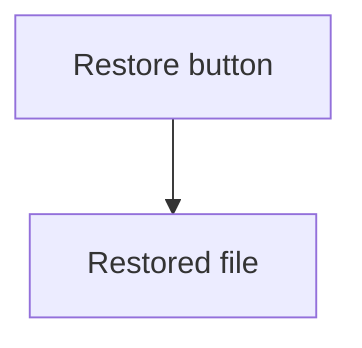

# nerDDocs

This doc covers what nerDDocs is and how to run it. It also covers how to write text at several levels and page content, split the docs into dimensions, read the terminal lines and see the plan.

nerDDocs is an open-source documentation platform. Each page holds its text at several levels, and the reader moves a slider on the page to switch between them. The author names the levels, and moving to another level changes the text of the page.

A book can come at third-grade, high-school and university levels. Technical docs can come at levels for managers, developers and testers.

## Run nerDDocs

Set up a clone, as [CONTRIBUTING.md](CONTRIBUTING.md#set-up-a-clone) says. Then run this command in the clone:

```sh
npx nerddocs
```

The command shows `./docs` as a site, prints its address and opens it in your browser. Press `Ctrl+C` to stop the command.

To show the docs of the backup app from another folder, run this command:

```sh
npx nerddocs ../backup-app/guide
```

| Argument | What it does |
|---|---|
| `[folder]` | Sets the folder to show. The default is `./docs` when it exists, and the current folder otherwise. |
| `--port <port>` | Sets the first port to try. A busy port moves to the next port. The default is `4000`. |
| `--no-open` | Keeps the browser closed. |

Each folder becomes a section of the contents panel, and each Markdown file becomes a page. The first heading of a file is its title, and the file name is the title of a file with no heading.

File names set the order, so `01-restore.md` comes before `02-schedules.md`. A file named `index.md` or `README.md` comes first in its folder. Dot folders, dot files, `node_modules` and a top folder named `__nerddocs` stay out of the site.

Each save of a Markdown file or of `nerddocs.json` shows on the open site with no reload, and the reader stays at the same place on the page.

## Write text at several levels

Levels need a file named `nerddocs.json` in the folder that the command shows. The file lists the levels:

```json
{
  "levels": [
    { "id": "overview", "name": "Overview", "icon": "eye" },
    { "id": "requirements", "name": "Requirements", "icon": "list" },
    { "id": "internals", "name": "Internals", "icon": "cpu" }
  ],
  "defaultLevel": "overview"
}
```

| Key | What it does |
|---|---|
| `levels` | Lists the levels in the order of their stops on the slider. Each level needs an `id`. Set it to `false` for a site with no levels. |
| `name` | Sets the name that the stop shows. The default comes from the id, so `on-call` shows as 'On call'. |
| `icon` | Sets the icon of the stop: `eye`, `list`, `cpu`, `brief`, `code`, `flask`, `book` or `clock`. The default is the first letter of the name in a circle. |
| `defaultLevel` | Sets the level that a page opens at. The default is the first level. |
| `wordsPerMinute` | Sets the reading speed that the read time uses, as a number above 0. The default is `238`. |
| `textWidth` | Sets the characters on a line of text, as a number above 0. The default is `75`. |

Every key except `id` is optional. A level id holds letters, digits, `-`, `_` and `.`.

The file decides what a page shows:

| File | What the page shows |
|---|---|
| The file is missing | A modal with the title 'No nerddocs.json'. No slider shows, and each fence line shows as text. |
| The file is broken or cannot be read | A modal with the title 'Broken nerddocs.json'. No slider shows, and each fence line shows as text. |
| The file lists no levels, or has `"levels": false` | No modal shows. No slider shows, and each fence line shows as text. |
| The file lists one level | No modal shows. No slider shows, and the text of that level shows with no fence line. |
| The file lists two or more levels, and the page has no part | The toolbar says 'No levels on this page'. |

To keep a site with no levels free of the modal, write `{ "levels": false }` in the file. The box 'Don't show again' in the modal holds for that browser only.

### Mark text with fences

A fence marks text for one or more levels. A line with `:::` and level ids opens a part, and a line with `:::` alone closes it.

This file is the 'Restore a file' page of the backup app:

```md
# Restore a file

::: overview
Pick a file and a day, and the app puts that copy back.

::: requirements
The app restores any file from any day that it still keeps a copy of.

::: internals
A restore is a job on the storage server.
:::

## Pick a day

::: overview requirements
Click a day on the calendar. A day with a copy has a dot.

::: internals
The rule takes the newest closed copy of that day.
:::

A restore never changes the copy in storage.
```

These rules hold for each fence and each part:

- Text outside a fence shows at every level.
- A new opening fence closes the part before it, and the end of the file closes an open part.
- A fence starts at the left margin, with at most three spaces before it.
- A fence line inside a code block stays text.
- A fence line with an id that `nerddocs.json` does not list stays text on its own line. It neither opens nor closes a part.
- A line with `:::` alone stays text on its own line when no part is open.
- A heading inside a fence never becomes the title of the page.
- A top-level shared heading or `<details>` hides at a level with no text in it, when another level has text there. The text of a heading runs to the next heading of the same or higher rank.

To show a line with `:::` inside a part, write `\:::`. The page prints `:::`, and the part stays open.

A fence goes between blocks only. Write a list or a table whole in each part, and write a changed sentence as a whole paragraph in each part.

### See which level a page opens at

A page opens at the level that you last chose for it in this tab. With no such level, it opens at your default level, and otherwise at the level that `defaultLevel` sets. A page with no text at that level opens at the nearest lower level with text, or else at the nearest higher level with text.

After a move of the slider, the button 'All pages' sets the current level as your default. The 'Defaults' button sets any level as your default. When a page that you moved would open at another level, the modal 'Change 2 pages?' lists each such page first. Your default holds in this browser, and it replaces the level that you chose for each page.

### See the read time

On a wide window, each stop of the slider shows the read time of the page at that level. On a phone, the row above the slider shows the read time of the current level.

The clock button opens a box with a table. The table gives the read time of each level on 'This page' and on 'All pages'.

The read time shows next to the title after a click on 'Hide panel', and on a page with no slider.

The read time counts the words, images, box diagrams, Mermaid diagrams and HTML wireframes that a level shows. Its words include the text of code blocks, tables and API references. A word is any text between spaces that holds a letter or a digit, in every language. Each image, each diagram and each wireframe adds 12 seconds, and a light and dark pair adds 12 seconds once. The text of a diagram or a wireframe counts no words. The title counts when the level shows a word, an image, a diagram or a wireframe. A read time rounds up to a whole minute.

### Pick a theme

The 'Themes' button opens a box of themes. On a phone, the button is at the foot of the contents panel. The box shows a list of the themes and a sample page. A click on a theme shows it on the sample page. Type a part of a theme name in 'Search' to list only the themes with that name. The up and down arrow keys move through the list.

The switch 'Light', 'Dark' and 'System' sets the look. 'System' follows the light or dark setting of the computer. The sample page and the list show that look at once.

'Apply', or Enter, changes the theme and the look of every page in that browser. 'Cancel', Esc or a click outside the box closes it and changes nothing.

### Set the text width

A line of text holds the characters that `textWidth` sets, counted in the body font of the theme. The text narrows with the window down to a column of 288 px. A window narrower than 320 px scrolls sideways.

In a window 960 px wide or wider, the 'Text width' button in the bar opens a menu. 'Show ruler' shows the ruler at the top of the window, and 'Restore default' sets the width of `textWidth` again. A narrower window has no 'Text width' button.

Drag either handle of the ruler, or click the ruler, and both edges of the text move. The number in the middle of the ruler is the width in characters. With the focus on the right handle, the arrow keys step 5 characters, and Page Up and Page Down step 25. Home gives the narrowest text, and End makes the text as wide as the page allows.

'Restore' sets the width that the ruler opened with. 'Apply', or a click on 'Text width', closes the ruler and keeps the width.

Your width holds on every page in that browser. Each change of the width keeps the text on the line 30% down the window in place. A page scrolled to the top stays at the top.

## Write page content

A page takes its content from plain Markdown, as on GitHub. Each kind of content in this section can go inside a fence, and it then shows only at the levels of the fence.

### Write headings

Write each heading as on GitHub, such as `## Pick a file` and `### Search index`. This file is the 'Restore a file' page of the backup app:

```md
# Restore a file

Pick a file and a day, and the app puts that copy back.

## Pick a file

Type a part of the file name, and click the file.

::: internals
### Search index

The agent keeps a list of the file paths of each copy.
:::

## Pick a day

Click a day on the calendar. A day with a copy has a dot.
```

The contents panel lists the headings of the open page under the row of the page. It lists the two highest ranks of heading that the page uses, such as `##` and `###`. A row of the lower rank sits one step further in, as 'Search index' does.

In a file that uses `#` for its sections, the first `#` heading is the title, and each other `#` heading gets a row.

A heading inside a fence has a row only at the levels of the fence, so the row 'Search index' shows at 'Internals' only. A heading of any lower rank, a heading inside `<details>` and the footnotes heading get no row.

The row of the section on the line 30% down the window is bold. A click on a row brings its heading near the top of the window. A click on the row of the page goes to the top of the page.

A click on the arrow 'Outline' before the row of the page folds the rows away, and a second click shows them. Each page that opens shows its rows again.

On a phone, the menu opens with the row of the page near the top and the bold row in view. A tap on a row closes the menu and shows its heading.

### Write tables

Write a table as on GitHub. This table is on the 'Schedules' page of the backup app:

```md
| Plan | Runs | Copies kept | Days | Storage |
|:---|:---|---:|---:|:---|
| Basic | Daily | 14 | 14 | Local disk |
| Team | Every 6 hours | 120 | 30 | Local disk and S3 |
| Archive | Weekly | 52 | 365 | S3 Glacier |
```

Alignment marks such as `|:---|---:|` work as on GitHub. A raw HTML `<table>` shows the same way as a Markdown table.

A table stays inside the text column. A table wider than the column scrolls sideways in its own box, and a fade shows at each edge where columns hide.

While a table scrolls, a first column of at most a third of the box stays in place, and a line marks its edge. A table with a cell that spans two rows or two columns keeps no column in place.

A cell of up to 12 characters stays on one line. A longer cell wraps at its spaces, and code in a cell never breaks.

Tab reaches a table that scrolls, and the arrow keys scroll it. A screen reader names the box of the table by the heading above it.

A wider text shows more columns at once, as [Set the text width](#set-the-text-width) says.

### Write code blocks

Write the language word after the opening fence, as on GitHub, such as ```` ```sh ````. This block is on the 'Restore by script' page of the backup app:

````md
```sh
# Restore one file from yesterday
curl -X POST https://backup.example.com/restores \
  -H "Authorization: Bearer $TOKEN" \
  -d '{"file": "/home/ana/report.pdf", "day": "2026-11-01", "target": "original"}'
```
````

The code shows in the code colors of the theme and the look. These languages get code colors. A fence word matches in any case, so `JSON` works as `json` does.

| Language | Fence words |
|---|---|
| Shell | `sh`, `bash`, `shell`, `zsh`, `shellscript` |
| Shell session | `console`, `shellsession` |
| PowerShell | `powershell`, `ps`, `ps1`, `pwsh` |
| JSON | `json` |
| JSON with comments | `jsonc` |
| YAML | `yaml`, `yml` |
| TOML | `toml` |
| INI | `ini`, `properties` |
| XML | `xml` |
| HTML | `html` |
| CSS | `css` |
| JavaScript | `javascript`, `js`, `cjs`, `mjs` |
| TypeScript | `typescript`, `ts`, `cts`, `mts` |
| Python | `python`, `py` |
| Go | `go` |
| Rust | `rust`, `rs` |
| Java | `java` |
| C | `c` |
| C# | `csharp`, `cs`, `c#` |
| SQL | `sql` |
| Diff | `diff` |
| Dockerfile | `docker`, `dockerfile` |
| Markdown | `markdown`, `md` |

A fence with no word, with `text` or with another word shows the code in the text color.

A line wider than the column scrolls sideways in its own box, and it never wraps. Tab reaches a block that scrolls, and the arrow keys scroll it.

The copy icon at the top right of a block copies its code. A check shows in its place once the code is copied.

### Write box diagrams

Draw a box diagram with box characters, such as `┌─┐`, `│` and `├──`, inside a code block. This diagram is on the 'Architecture' page of the backup app:

````md
```
┌──────────────┐    copy list    ┌────────────────┐
│ Backup agent │ ──────────────▶ │ Storage server │
│  on the PC   │ ◀────────────── │  keeps copies  │
└──────────────┘   file blocks   └────────────────┘
```
````

A code block with any character from `─` (U+2500) to `╿` (U+257F) shows as a box diagram, with or without a language word.

A box diagram shows in the font Fira Code in every theme. Each line joins and each column stays in place, also on a phone. A page loads Fira Code only when it shows a box diagram.

A diagram wider than the column scrolls sideways, and its lines never wrap.

A box diagram has the copy icon of a code block, in a strip above its first line.

### Write Mermaid diagrams

Write a Mermaid block as on GitHub, with the word `mermaid` after the opening fence. This diagram is on the 'User flows' page of the backup app:

````md

````

The page draws the diagram in the colors and the UI font of the theme. A switch of theme or look draws it again. The command serves Mermaid itself, so a diagram draws with no internet.

A diagram draws when its level shows and it comes near the view. Before it draws, it holds its space on the page. The space is the size that this browser last drew it at in that look, or else the width of the column at 5:3.

An `accTitle:` line, such as `accTitle: Restore a file`, names the diagram for screen readers. An `accDescr:` line describes it.

Math between `$$`, `mindmap`, `architecture-beta` and the ELK layout, such as `layout: elk`, need the full build of Mermaid. A page with one of them loads the full build by itself and draws each of its diagrams with that build.

A click, a tap, or Enter or Space on a drawn diagram opens it full size. Esc, a click or a tap closes it. A diagram wider than the column shrinks down to three quarters of its size, then scrolls sideways.

A node that you color, such as with `style B fill:#f96`, keeps its color, and its text turns black or white.

A diagram that Mermaid cannot read shows its source under the line `Bad Mermaid: user-flows.md:14`. The number is the line of the Markdown file where Mermaid finds the problem. When Mermaid names no line, it is the line of the opening fence. The terminal prints nothing for it. With scripts off, the source shows as code.

### Write images

Write an image as on GitHub, on a line of its own. This image is on the 'Restore a file' page of the backup app:

```md

```

The path starts from the folder of the Markdown file. A path that starts with `/` starts from the docs folder. A PNG, JPEG, GIF, WebP, SVG or AVIF file shows as an image. A raw `` on a line of its own shows the same way.

To set the width of an image, write it as a raw `` with a `width` in pixels:

```html

```

To show a light copy and a dark copy of an image, write the two images on two lines, as on GitHub:

```md


```

A `<picture>` with a `<source>` for the dark look shows the two copies the same way:

```html
<picture>
  <source media="(prefers-color-scheme: dark)" srcset="restore-window-dark.png">
  
</picture>
```

The page shows the copy of the look that the theme box sets. With 'System', the page shows the copy of the look of the computer.

A click, a tap, or Enter or Space on an image on a line of its own opens the image full size. Esc, a click or a tap closes it. An image inside a line of text or inside a link stays in the text, and a click on a linked image follows the link.

A PNG, JPEG, GIF or WebP file in the docs folder holds its space on the page before it loads. So does an SVG file in the docs folder with a `width` and a `height`, or with a `viewBox`. A raw `` with a `width` and a `height` in pixels holds its space for any file.

A save of an image file shows the new image on each open page.

A missing image on a line of its own shows as a dashed box with the line `Missing file: restore-window.png restore.md`. The terminal prints the same line with the full path of the Markdown file.

### Write HTML wireframes

Write an HTML wireframe as an image of its `.html` file, on a line of its own. This wireframe is on the 'Design decisions' page of the backup app:

```md

```

The page shows the wireframe as a live page in a box as wide as the text and as tall as the wireframe. A click in the box works as in the wireframe on its own and changes nothing else on the page. The box grows with the wireframe, and the text on the line 30% down the window stays in place. A wireframe wider than the text scrolls sideways inside its box.

Write each wireframe as one HTML file with all its steps. Name its other files by a path from the folder of the wireframe, and load each script with a plain tag, such as `<script src="wizard.js"></script>`. A link such as `<a href="#step-2">` with a `:target` style shows a step. A link to another HTML file opens that file in the box, and the box keeps its height.

A wireframe has its own document, with its own style and its own scripts. Its scripts can still read and change the page through `parent`. A wireframe sees the light or dark setting of the computer, not the look of the theme.

The full-size icon at the top right of the box shows the wireframe in the whole window, in the same state. Esc or the close icon puts it back.

Before it loads, a wireframe holds its space on the page. The space is the height that this browser last measured for it, or else the width of the text at 5:3.

A save of the wireframe shows the new wireframe on each open page. So does a save of a file that it names in a `src` or `href` attribute. A change to any other file that the wireframe names, such as in its CSS or its scripts, shows after a reload.

A missing wireframe shows as a dashed box with the line `Missing file: wireframes/restore-wizard.html design-decisions.md`. An image of a wireframe inside a line of text shows as a link to the file.

### Write API references

Write an API reference as an image of its OpenAPI file, on a line of its own. The file sits in the docs folder, and its name ends in `.yaml`, `.yml` or `.json`. This reference is on the 'Backup API' page of the backup app, at the level 'Internals':

```md
# Backup API

::: overview requirements
The backup app has an API for scripts.

::: internals

:::
```

nerDDocs reads OpenAPI 2.0, 3.0, 3.1 and 3.2, in YAML or JSON. YAML reads `openapi: 3.0` as a number, so write `openapi: 3.0.3` or `openapi: '3.0'`.

The page shows each endpoint as a heading, such as `POST /restores`, with its parameters, its body, its responses and its examples. The headings start one rank below the heading above the image. When the endpoints have two or more first tags, each tag shows as a heading above its endpoints. An endpoint shows once, under its first tag.

To show the endpoints of one tag, write the tag after a `#`, such as ``. The tag matches only in the same case. To link to an endpoint from another page, use the id of its heading, such as `[Start a restore](../api.md#post-restores)`. To let readers get the file, write an ordinary link, such as `[openapi.yaml](api/openapi.yaml)`.

A `$ref` points inside the file, such as `#/components/schemas/Restore`. It can also point to another file of the docs folder, by a path from the file that holds it, such as `schemas/restore.yaml`. A `$ref` to an `https` address shows as unresolved.

A save of the OpenAPI file, or of a file that a `$ref` names, shows the new reference on each open page.

An OpenAPI file that is not valid shows as a dashed box with a line such as `Bad OpenAPI: api/openapi.yaml:9`. The number is the line of the problem. A tag that the file does not name shows as a dashed box with the line `Unknown tag: Restores api.md`.

A `$ref` that points nowhere shows a line such as `Unresolved ref: #/components/schemas/Snapshot api/openapi.yaml:18` where its schema, response or parameter would show. The rest of the reference shows. A `$ref` of any other part leaves that part out, and only the terminal prints the line.

An image of an OpenAPI file inside a line of text shows as a link to the file.

## Split the docs into dimensions

A dimension is a top folder of the docs that the contents panel shows on its own. The docs of the backup app have three dimensions: 'User guide', 'Administration' and 'Legal and privacy'. The key `dimensions` in `nerddocs.json` lists them:

```json
{
  "dimensions": [
    { "folder": "user-guide" },
    { "folder": "administration" },
    { "folder": "legal", "name": "Legal and privacy" }
  ]
}
```

| Key | What it does |
|---|---|
| `dimensions` | Lists the dimensions in the order that the list of dimensions shows them. |
| `folder` | Sets the top folder of the dimension, such as `user-guide`. Each dimension needs a `folder`. |
| `name` | Sets the name that the button and the list show. The default comes from the folder name, so `user-guide` shows as 'User guide'. |

A `folder` holds no `/`, and each folder shows once in the list. Any other value of `dimensions` makes the file broken.

The button above the contents tree shows the name of the dimension of the open page. The tree shows the pages and the folders inside the folder of that dimension. On a phone, the button is at the top of the contents panel.

A click on the button opens the list of dimensions. A click on another dimension opens the page of that dimension that you last opened in that browser. A dimension with no such page opens at its first page. A click on the dimension of the open page closes the list. The up and down arrow keys move through the list, and Esc closes it.

A page opens at the level that [See which level a page opens at](#see-which-level-a-page-opens-at) gives. Every dimension has the levels of `nerddocs.json`. 'All pages' in the read time box counts the pages of every dimension.

Each page keeps the address of its file, such as `/user-guide/backups/01-restore.html`. The address of the site opens the first page of the first dimension.

A Markdown file or a folder of pages outside every listed folder stays out of the site. A listed folder that is missing or holds no page stays out of the list. The terminal prints a line for each, as [Read the terminal lines](#read-the-terminal-lines) says.

With one dimension, the site shows only the pages of its folder, and no button shows. When no listed folder holds a page, the site shows every folder, as with no `dimensions` key.

## Read the terminal lines

The command prints each problem in the terminal:

| Line | What it means |
|---|---|
| `Missing config: <file>` | The folder has no `nerddocs.json`. |
| `Bad config: <file>` | `nerddocs.json` is not valid. |
| `Cannot read: <file>` | The command cannot read a file or a folder of the site, such as `nerddocs.json`. |
| `Unknown level: <id> <file>` | The file uses an id that `nerddocs.json` does not list. A fence line with that id stays text. |
| `Unknown icon: <name> <file>` | `nerddocs.json` names an icon outside the list. The level shows its default icon. |
| `Missing dimension: <folder> <file>` | `nerddocs.json` lists a folder that is missing or holds no page. The list of dimensions leaves it out. |
| `Outside dimensions: <path>` | A Markdown file or a folder of pages sits outside every folder that `dimensions` lists. It stays out of the site. |
| `Missing file: <target> <file>` | The file shows an image, a wireframe or an OpenAPI file that is missing or outside the docs folder. A path with a name that starts with a dot, or with `node_modules`, counts as outside. |
| `Bad OpenAPI: <file>:<line>` | `<file>` is an OpenAPI file or a file that its `$ref` names. It is not valid YAML or JSON, or the OpenAPI file is not OpenAPI 2.0, 3.0, 3.1 or 3.2. |
| `Unresolved ref: <ref> <file>:<line>` | A `$ref` of the OpenAPI file points to nothing in the docs folder, or to an address such as `https://`. |
| `Unknown tag: <tag> <file>` | The file names a tag after the `#` of an OpenAPI file, and neither the `tags` nor the endpoints of that file list it. |

## See the plan

Set up a clone, as [CONTRIBUTING.md](CONTRIBUTING.md#set-up-a-clone) says. Then run this command in the clone:

```sh
npx roadmapper dev roadmap/roadmap.json
```

Open the address that the command prints. The page shows the plan and redraws it each time `roadmap/roadmap.json` is saved.

## Learn more

| Subject | Doc |
|---|---|
| What readers, authors, teams and AI tools do with nerDDocs | [docs/use-cases.md](docs/use-cases.md) |
| The parts that nerDDocs is built from | [docs/tech-stack.md](docs/tech-stack.md) |
| How to work on nerDDocs | [CONTRIBUTING.md](CONTRIBUTING.md) |
| The license, MIT | [LICENSE](LICENSE) |
