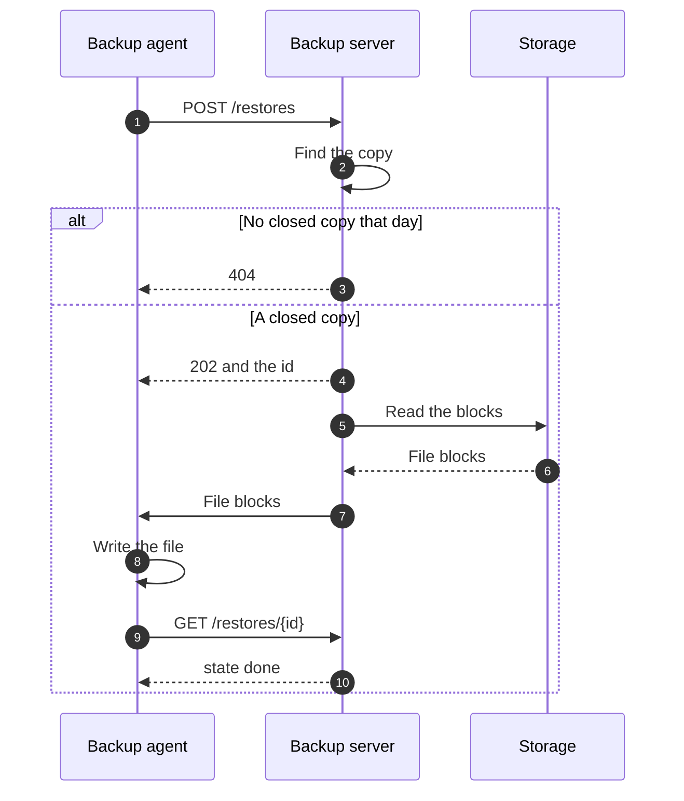
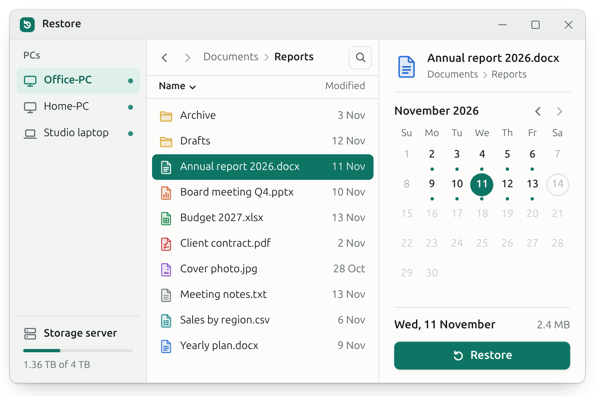

# Page content

::: casual
A page shows plain Markdown as GitHub does. Each section below shows one kind of content at work, taken from the docs of a backup app: tables, code, diagrams, pictures and even a live wireframe.

::: pro
A page takes its content from plain Markdown, as on GitHub. It can hold headings, tables, code blocks, box diagrams, Mermaid diagrams, images, live HTML wireframes and API references. Each section of this page tells one kind of content, then shows the Markdown of an example from the docs of a backup app, and then draws the example. Any kind of content can go inside a fence, and it then shows only at the levels of the fence.

::: full-nerd
A page takes its content from plain Markdown, as on GitHub. It can hold headings, tables, code blocks, box diagrams, Mermaid diagrams, images, live HTML wireframes and API references. Each section of this page tells one kind of content, then shows the Markdown of an example from the docs of a backup app, and then draws the example outside any fence, so it shows at every level. The files of the examples sit in the folder `examples/` next to this page. The docs of the backup app have the levels 'Basics', 'Details' and 'Internals'.

Any kind of content can go inside a fence, such as `::: pro full-nerd`, and it then shows only at the levels of the fence.
:::

## Headings

::: casual
You write each heading as on GitHub. The outline lists the headings of the open page, as it lists the sections of this page. A click on a row brings its heading near the top of the window.

::: pro full-nerd
Write each heading as on GitHub, such as `## Pick a file` and `### Search index`. The outline lists the headings of the open page. It lists the two highest ranks of heading that the page uses, such as `##` and `###`, and a row of the lower rank sits one step further in. A click on a row brings its heading near the top of the window, and the row of the section on the line 30% down the window is bold.

In a window 1200 px wide or wider, the outline is a column on the right of the text, and the button 'Hide outline' at the top of the column hides it. In a narrower window, the button 'Outline' in the bottom bar opens it at the right side of the window.

::: full-nerd
In a file that uses `#` for its sections, the first `#` heading is the title, and each other `#` heading gets a row.

A heading inside a fence has a row only at the levels of the fence. A page has no outline at a level where none of its headings shows. A heading of any lower rank, a heading inside `<details>` and the footnotes heading get no row.

After 'Hide outline', the button 'Show outline' in the top right corner shows the outline again. Your choice holds on every page in that browser. In a narrower window, a click on a row, Esc or 'Close outline' closes the outline.

A click on the row of the open page in the contents panel goes to the top of the page. On a phone, the contents panel opens with the row of the open page at the top.

::: pro full-nerd
This Markdown is the 'Restore a file' page of the backup app. Its outline holds the rows 'Pick a file' and 'Pick a day', and at 'Internals' only, the row 'Search index' one step further in:

```md
# Restore a file

Pick a file and a day, and the app puts that copy back.

## Pick a file

Type a part of the file name, and click the file.

::: internals
### Search index

The agent keeps a list of the file paths of each copy.
:::

## Pick a day

Click a day on the calendar. A day with a copy has a dot.
```

The outline of this page works the same way. Its rows are the sections from 'Headings' to 'API references', and the tags 'Restores' and 'Schedules' of the API reference sit one step further in.
:::

## Tables

::: casual
You write a table as on GitHub, such as this table of the backup plans. A table wider than the text scrolls sideways in its own box, and a fade shows at each edge where columns hide.

::: pro full-nerd
Write a table as on GitHub. Alignment marks such as `|:---|---:|` work as on GitHub, and a raw HTML `<table>` shows the same way as a Markdown table. A table stays inside the text column. A table wider than the column scrolls sideways in its own box, and a fade shows at each edge where columns hide.

::: full-nerd
While a table scrolls, a first column of at most a third of the box stays in place, and a line marks its edge. A table with a cell that spans two rows or two columns keeps no column in place.

A cell of up to 12 characters stays on one line. A longer cell wraps at its spaces, and code in a cell never breaks.

Tab reaches a table that scrolls, and the arrow keys scroll it. A screen reader names the box of the table by the heading above it. A wider text shows more columns at once, as [Set the text width](../02-read-a-page.md#set-the-text-width) says.

::: pro full-nerd
This Markdown is the table of the plans on the 'Schedules' page of the backup app:

```md
| Plan | Day | Runs at | Kept for | Storage |
|:---|:---|---:|:---|:---|
| Daily | Every day | 02:00 | 14 days | Local disk |
| Weekly | Sunday | 03:00 | 8 weeks | Local disk and S3 |
| Monthly | The 1st | 04:00 | 1 year | S3 Glacier |
```
:::

| Plan | Day | Runs at | Kept for | Storage |
|:---|:---|---:|:---|:---|
| Daily | Every day | 02:00 | 14 days | Local disk |
| Weekly | Sunday | 03:00 | 8 weeks | Local disk and S3 |
| Monthly | The 1st | 04:00 | 1 year | S3 Glacier |

## Code blocks

::: casual
A code block shows code in the colors of its language, such as this restore script of the backup app. The copy icon at the top right of the block copies its code.

::: pro full-nerd
Write the language word after the opening fence, as on GitHub, such as ```` ```ts ````. The code then shows in the colors of its language, and the theme and the look set those colors. The copy icon at the top right of a block copies its code, and a check shows in its place once the code is copied.

::: full-nerd
These languages get code colors. A fence word matches in any case, so `JSON` works as `json` does.

| Language | Fence words |
|---|---|
| Shell | `sh`, `bash`, `shell`, `zsh`, `shellscript` |
| Shell session | `console`, `shellsession` |
| PowerShell | `powershell`, `ps`, `ps1`, `pwsh` |
| JSON | `json` |
| JSON with comments | `jsonc` |
| YAML | `yaml`, `yml` |
| TOML | `toml` |
| INI | `ini`, `properties` |
| XML | `xml` |
| HTML | `html` |
| CSS | `css` |
| JavaScript | `javascript`, `js`, `cjs`, `mjs` |
| TypeScript | `typescript`, `ts`, `cts`, `mts` |
| Python | `python`, `py` |
| Go | `go` |
| Rust | `rust`, `rs` |
| Java | `java` |
| C | `c` |
| C# | `csharp`, `cs`, `c#` |
| SQL | `sql` |
| Diff | `diff` |
| Dockerfile | `docker`, `dockerfile` |
| Markdown | `markdown`, `md` |

A fence with no word, with `text` or with another word shows the code in the text color.

A line wider than the column scrolls sideways in its own box, and it never wraps. Tab reaches a block that scrolls, and the arrow keys scroll it.

::: pro full-nerd
This Markdown is the script on the 'Restore by script' page of the backup app. The script starts a restore through the API of the backup app, then checks the restore until it ends:

````md
```ts
type Restore = {
  id: string;
  state: 'queued' | 'running' | 'done' | 'failed';
  file: string;
  bytesDone: number;
};

const api = 'https://backup.example.com/api/v2';
const headers = {
  Authorization: `Bearer ${process.env.BACKUP_TOKEN}`,
  'Content-Type': 'application/json',
};

// Restore report.pdf from 1 November to a new folder.
const started = await fetch(`${api}/restores`, {
  method: 'POST',
  headers,
  body: JSON.stringify({
    file: '/home/ana/report.pdf',
    day: '2026-11-01',
    target: { kind: 'folder', folder: '/home/ana/old' },
  }),
});
if (started.status === 404) {
  throw new Error('No copy of the file on that day');
}

// Check the restore every 2 seconds until it ends.
let restore: Restore = await started.json();
const ended = ['done', 'failed'];
while (!ended.includes(restore.state)) {
  await new Promise((wait) => setTimeout(wait, 2000));
  const url = `${api}/restores/${restore.id}`;
  restore = await (await fetch(url, { headers })).json();
}
console.log(`${restore.file}: ${restore.state}`);
```
````
:::

```ts
type Restore = {
  id: string;
  state: 'queued' | 'running' | 'done' | 'failed';
  file: string;
  bytesDone: number;
};

const api = 'https://backup.example.com/api/v2';
const headers = {
  Authorization: `Bearer ${process.env.BACKUP_TOKEN}`,
  'Content-Type': 'application/json',
};

// Restore report.pdf from 1 November to a new folder.
const started = await fetch(`${api}/restores`, {
  method: 'POST',
  headers,
  body: JSON.stringify({
    file: '/home/ana/report.pdf',
    day: '2026-11-01',
    target: { kind: 'folder', folder: '/home/ana/old' },
  }),
});
if (started.status === 404) {
  throw new Error('No copy of the file on that day');
}

// Check the restore every 2 seconds until it ends.
let restore: Restore = await started.json();
const ended = ['done', 'failed'];
while (!ended.includes(restore.state)) {
  await new Promise((wait) => setTimeout(wait, 2000));
  const url = `${api}/restores/${restore.id}`;
  restore = await (await fetch(url, { headers })).json();
}
console.log(`${restore.file}: ${restore.state}`);
```

## Box diagrams

::: casual
A box diagram is a drawing of boxes and lines, made of box characters in a code block. Each line joins and each column stays in place, also on a phone. This one shows the parts of the backup app.

::: pro full-nerd
A box diagram is a drawing of boxes and lines. Draw one with box characters, such as `┌─┐`, `│` and `├──`, inside a code block. A code block with any character from `─` (U+2500) to `╿` (U+257F) shows as a box diagram, with or without a language word. Each line joins and each column stays in place, also on a phone.

::: full-nerd
A box diagram shows in the font Fira Code in every theme. A page loads Fira Code only when it shows a box diagram.

A diagram wider than the column scrolls sideways, and its lines never wrap. A box diagram has the copy icon of a code block, in a strip above its first line.

::: pro full-nerd
This Markdown is the diagram of the parts of the backup app, on its 'Architecture' page:

````md
```
┌────────────────┐   ┌────────────────┐   ┌────────────────┐
│ Office-PC      │   │ Home-PC        │   │ Studio laptop  │
│ Backup agent   │   │ Backup agent   │   │ Backup agent   │
└───┬────────────┘   └───┬────────────┘   └───┬────────────┘
    │        ▲           │        ▲           │        ▲
    │ backup │ restored  │        │           │        │
    ▼ blocks │ blocks    ▼        │           ▼        │
┌────────────┴────────────────────┴────────────────────┴───┐
│ Backup server   https://backup.example.com/api/v2        │
│ ┌────────────────────────┐   ┌─────────────────────────┐ │
│ │ Job queue              │   │ Copy index              │ │
│ │ Backups and restores,  │   │ Each copy of each file, │ │
│ │ each in its turn       │   │ its day, open or closed │ │
│ └────────────────────────┘   └─────────────────────────┘ │
└──────────────────────────────────────────────────────────┘
                              ▲
                              │ file blocks
         ┌────────────────────┼────────────────────┐
         ▼                    ▼                    ▼
┌────────────────┐   ┌────────────────┐   ┌────────────────┐
│ Local disk     │   │ S3             │   │ S3 Glacier     │
│ Daily, Weekly  │   │ Weekly         │   │ Monthly        │
└────────────────┘   └────────────────┘   └────────────────┘
```
````
:::

```
┌────────────────┐   ┌────────────────┐   ┌────────────────┐
│ Office-PC      │   │ Home-PC        │   │ Studio laptop  │
│ Backup agent   │   │ Backup agent   │   │ Backup agent   │
└───┬────────────┘   └───┬────────────┘   └───┬────────────┘
    │        ▲           │        ▲           │        ▲
    │ backup │ restored  │        │           │        │
    ▼ blocks │ blocks    ▼        │           ▼        │
┌────────────┴────────────────────┴────────────────────┴───┐
│ Backup server   https://backup.example.com/api/v2        │
│ ┌────────────────────────┐   ┌─────────────────────────┐ │
│ │ Job queue              │   │ Copy index              │ │
│ │ Backups and restores,  │   │ Each copy of each file, │ │
│ │ each in its turn       │   │ its day, open or closed │ │
│ └────────────────────────┘   └─────────────────────────┘ │
└──────────────────────────────────────────────────────────┘
                              ▲
                              │ file blocks
         ┌────────────────────┼────────────────────┐
         ▼                    ▼                    ▼
┌────────────────┐   ┌────────────────┐   ┌────────────────┐
│ Local disk     │   │ S3             │   │ S3 Glacier     │
│ Daily, Weekly  │   │ Weekly         │   │ Monthly        │
└────────────────┘   └────────────────┘   └────────────────┘
```

## Mermaid diagrams

::: casual
A page draws each Mermaid diagram that you write as on GitHub, such as this restore in the backup app. The diagram takes the colors and the font of the theme, and it draws with no internet. A click on it opens it full size.

::: pro full-nerd
Write a Mermaid block as on GitHub, with the word `mermaid` after the opening fence. The page draws the diagram in the colors and the UI font of the theme, and a switch of theme or look draws it again. The command serves Mermaid itself, so a diagram draws with no internet. A click on a drawn diagram opens it full size.

An `accTitle:` line, such as `accTitle: Restore a file`, names the diagram for screen readers. An `accDescr:` line describes it.

::: full-nerd
A diagram draws when its level shows and it comes near the view. Before it draws, it holds its space on the page. The space is the size that this browser last drew it at in that look, or else the width of the column at 5:3.

Math between `$$`, `mindmap`, `architecture-beta` and the ELK layout, such as `layout: elk`, need the full build of Mermaid. A page with one of them loads the full build by itself and draws each of its diagrams with that build.

A tap, or Enter or Space, also opens a drawn diagram full size. Esc, a click or a tap closes it. A diagram wider than the column shrinks down to three quarters of its size, then scrolls sideways. A node that you color, such as with `style B fill:#f96`, keeps its color, and its text turns black or white.

A diagram that Mermaid cannot read shows its source under the line `Bad Mermaid: user-flows.md:14`. The number is the line of the Markdown file where Mermaid finds the problem. When Mermaid names no line, it is the line of the opening fence. The terminal prints nothing for it. With scripts off, the source shows as code.

::: pro full-nerd
This Markdown is the restore on the 'User flows' page of the backup app:

````md

````
:::


## Images

::: casual
A page shows images written as on GitHub. An image can have a light copy and a dark copy, and the page shows the copy that matches its look. Pick 'Dark' or 'Light' in the 'Themes' box, and this 'Restore' window changes with it. A click on the image opens it full size, and a missing image shows as a dashed box.

::: pro full-nerd
Write an image as on GitHub, on a line of its own. The path starts from the folder of the Markdown file, and a path that starts with `/` starts from the docs folder. A PNG, JPEG, GIF, WebP, SVG or AVIF file shows as an image. A click on an image on a line of its own opens it full size, and a missing image shows as a dashed box.

To set the width of an image, write it as a raw `` with a `width` in pixels:

```html

```

To show a light copy and a dark copy of an image, write the two images on two lines, as on GitHub. The page shows the copy of the look that the 'Themes' box sets, so a pick of 'Dark' or 'Light' there changes the 'Restore' window below.

::: full-nerd
A raw `` on a line of its own shows the same way as a Markdown image. A `<picture>` with a `<source>` for the dark look shows the two copies the same way:

```html
<picture>
  <source media="(prefers-color-scheme: dark)"
          srcset="examples/restore-dark.png">
  
</picture>
```

With 'System' in the 'Themes' box, the page shows the copy of the look of the computer.

A tap, or Enter or Space, also opens an image on a line of its own full size. Esc, a click or a tap closes it. An image inside a line of text or inside a link stays in the text, and a click on a linked image follows the link.

A PNG, JPEG, GIF or WebP file in the docs folder holds its space on the page before it loads. So does an SVG file in the docs folder with a `width` and a `height`, or with a `viewBox`. A raw `` with a `width` and a `height` in pixels holds its space for any file.

A save of an image file shows the new image on each open page.

A missing image on a line of its own shows as a dashed box with a line such as `Missing file: restore-window.png restore.md`. The terminal prints a 'Missing file' problem, as [Read the terminal lines](../04-check-the-docs.md#read-the-terminal-lines) says.

::: pro full-nerd
This Markdown is the 'Restore' window on the 'Restore a file' page of the backup app:

```md


```
:::


## HTML wireframes

::: casual
A page can show an HTML wireframe as a live page in a box, such as this restore wizard of the backup app. A click in the box works as in the wireframe on its own, and changes nothing else on the page. The icon at the top right of the box shows the wireframe in the whole window.

::: pro full-nerd
Write an HTML wireframe as an image of its `.html` file, on a line of its own. The page shows the wireframe as a live page in a box as wide as the text and as tall as the wireframe. A click in the box works as in the wireframe on its own, and changes nothing else on the page. The full-size icon at the top right of the box shows the wireframe in the whole window.

Write each wireframe as one HTML file with all its steps. Name its other files by a path from the folder of the wireframe, and load each script with a plain tag, such as `<script src="wizard.js"></script>`. A link such as `<a href="#step-2">` with a `:target` style shows a step. A link to another HTML file opens that file in the box, and the box keeps its height.

::: full-nerd
The box grows with the wireframe, and the text on the line 30% down the window stays in place. A wireframe wider than the text scrolls sideways inside its box.

A wireframe has its own document, with its own style and its own scripts. Its scripts can still read and change the page through `parent`. A wireframe sees the light or dark setting of the computer, not the look of the theme.

In the whole window, the wireframe keeps its state. Esc or the close icon puts it back in its box.

Before it loads, a wireframe holds its space on the page. The space is the height that this browser last measured for it, or else the width of the text at 5:3.

A save of the wireframe shows the new wireframe on each open page. So does a save of a file that it names in a `src` or `href` attribute. A change to any other file that the wireframe names, such as in its CSS or its scripts, shows after a reload.

A missing wireframe shows as a dashed box with a line such as `Missing file: wireframes/restore-wizard.html design-decisions.md`. An image of a wireframe inside a line of text shows as a link to the file.

::: pro full-nerd
This Markdown is the restore wizard on the 'Design decisions' page of the backup app:

```md

```
:::


## API references

::: casual
A page shows an API reference from an OpenAPI file, in YAML or JSON, such as this API of the backup app. Each endpoint shows as a heading, with its parameters, its body, its responses and its examples. When you save the file, each open page shows the new reference.

::: pro full-nerd
Write an API reference as an image of its OpenAPI file, on a line of its own. The file sits in the docs folder, and its name ends in `.yaml`, `.yml` or `.json`. nerDDocs reads OpenAPI 2.0, 3.0, 3.1 and 3.2, in YAML or JSON. YAML reads `openapi: 3.0` as a number, so write `openapi: 3.0.3` or `openapi: '3.0'`.

The page shows each endpoint as a heading, such as `POST /restores`, with its parameters, its body, its responses and its examples. The headings start one rank below the heading above the image. When the endpoints have two or more first tags, each tag shows as a heading above its endpoints, as 'Restores' and 'Schedules' do below. An endpoint shows once, under its first tag.

To show the endpoints of one tag, write the tag after a `#`, such as ``. The tag matches only in the same case. To link to an endpoint from another page, use the id of its heading, such as `[Start a restore](../api.md#post-restores)`. To let readers get the file, write an ordinary link, such as `[openapi.yaml](examples/api/openapi.yaml)`. When you save the file, each open page shows the new reference.

::: full-nerd
To show a reference at some levels only, write it in a fence. On the 'Backup API' page of the backup app, the reference shows at 'Internals' only:

```md
# Backup API

The backup app has an API for scripts.

::: internals

:::
```

A `$ref` points inside the file, such as `#/components/schemas/Restore`. It can also point to another file of the docs folder, by a path from the file that holds it, such as `schemas/restore.yaml`. A `$ref` to an `https` address shows as unresolved. A save of a file that a `$ref` names also shows the new reference on each open page.

An OpenAPI file that is not valid shows as a dashed box with a line such as `Bad OpenAPI: api/openapi.yaml:9`. The number is the line of the problem. A tag that the file does not name shows as a dashed box with a line such as `Unknown tag: Restores api.md`.

A `$ref` that points nowhere shows a line such as `Unresolved ref: #/components/schemas/Snapshot api/openapi.yaml:18` where its schema, response or parameter would show. The rest of the reference shows. A `$ref` of any other part leaves that part out, and only the terminal prints its 'Unresolved ref' problem.

An image of an OpenAPI file inside a line of text shows as a link to the file.

::: pro full-nerd
This Markdown is the reference of the backup app:

```md

```
:::


